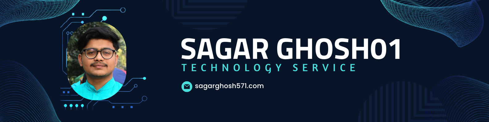

# Hi 👋, I'm Sagar Ghosh

### Software Engineer · Data & AI Builder · B.Tech CSE @ Lovely Professional University

  
  

  
  
  
  

---

## 👨‍💻 About Me

I'm a Computer Science undergraduate who loves turning messy real-world problems into working products, from edge-AI computer vision to financial reconciliation tools and customer analytics.

| | |
|---|---|
| 🔭 **Currently building** | My startup |
| 🌱 **Currently learning** | Advanced SQL, modern frameworks, LLMs |
| 🎓 **Education** | B.Tech CSE, Lovely Professional University (2024 – present) |
| 💼 **Experience** | Data Science & Visualisation Intern, Infosys (Feb – Apr 2026) |
| 🏆 **Achievement** | Webathon 2025: Top 5 finalist among 250+ teams |
| 📫 **Reach me** | sagarghosh571@gmail.com |

---

## 🛠️ Tech Stack

  
  
  
  
  
   
  
  
  
  
   
  
  
  
  
  

---

## 🚀 Featured Projects

| Project | What it does | Tech |
|---|---|---|
| 🛣️ **SRIMS** | Edge-AI road-defect detection with a live GIS dashboard for infrastructure monitoring | `YOLOv8` `ONNX` `React` `GIS` |
| 🏦 **FinCheck AI** | Automated bank-to-ledger reconciliation using fuzzy matching to cut manual review | `FastAPI` `React` `RapidFuzz` |
| 📊 **CustomerIQ** | Customer segmentation, churn prediction and lifetime-value forecasting with explainable AI | `K-Means` `Random Forest` `Ridge` `SHAP` |

> 🔗 Add a link to each repository (for example `[SRIMS](https://github.com/SagarGhosh01/<repo>)`) so visitors can jump straight in.

---

## 📈 GitHub Stats

---

## 🤝 Let's Collaborate

I'm open to internships, hackathons and open-source collaborations in **AI/ML, data analytics and full-stack development**. If you have an idea, let's build it.

*⭐ If you like what you see, drop a star on a repo!*

